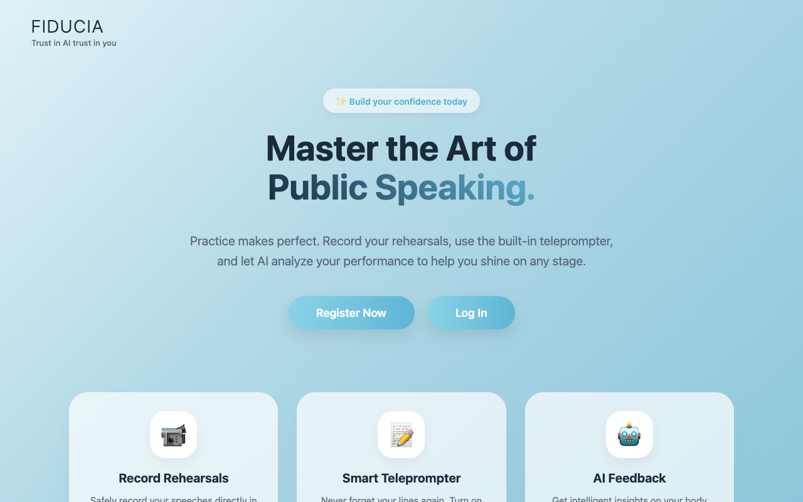
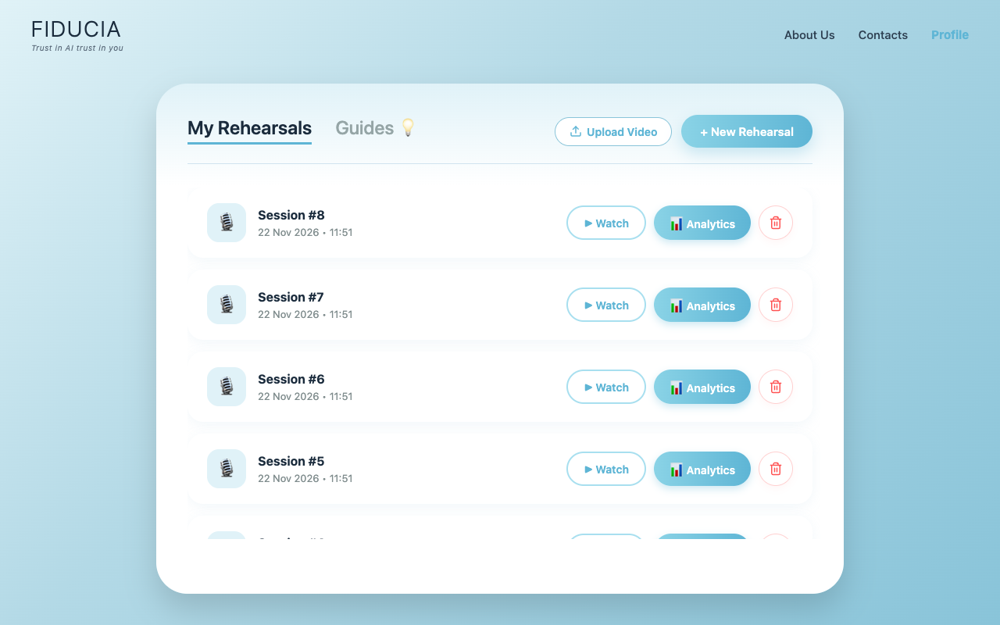
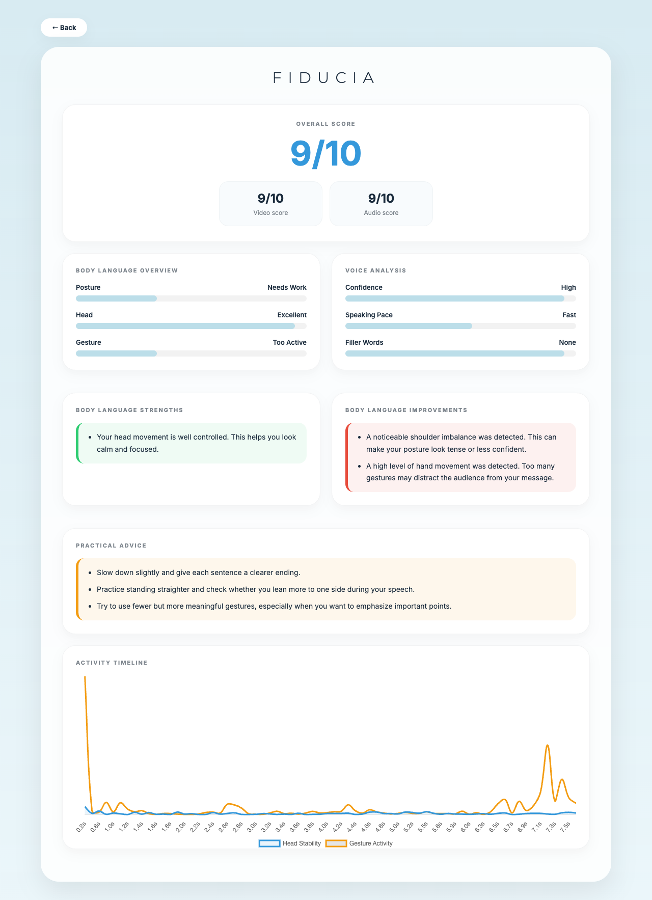

# FIDUCIA

[](https://github.com/zmiiovskyi/feducia/actions/workflows/ci.yml)

**Trust in AI, trust in you.** A web app for rehearsing public speaking: record or upload a talk and
get a report on body language and speech. The computer vision and speech models run on your own
machine, so recordings are not sent to an AI service.

> **About the project:** FIDUCIA started as a student project at the Faculty of Mechanics and
> Mathematics, Ivan Franko National University of Lviv. We built it as a team, with the support and
> guidance of our mentor, [arc-lena](https://github.com/arc-lena). The original team repository is
> [arc-lena/feducia](https://github.com/arc-lena/feducia).



## Features

- **Record or upload** a rehearsal (MP4, M4V, MOV, WebM, MKV up to 500 MB)
- **Teleprompter** with three reading speeds
- **Body language**: posture, head stability and gestures, with an activity timeline
- **Speech**: pace, pauses, repeated words and English filler words
- **Report** with a score, strengths, issues and practical advice
- **Accounts** with Google sign-in, password reset, avatars and points for practice
- **11 guides** on public speaking

<details>
<summary>More screenshots</summary>

### Dashboard


### Report


</details>

## How it works

1. **Record or upload.** You record a rehearsal in the browser or upload an existing video.
2. **Speech analysis.** ffmpeg extracts the audio and Whisper turns it into text. The app then
   measures pace, pauses, repeated words and filler words.
3. **Body language analysis.** OpenCV reads the video and MediaPipe tracks the head, shoulders and
   hands to evaluate posture, stability and gestures.
4. **Report.** Both results are combined into a score (60% body language, 40% speech) and shown
   with strengths, issues, advice and an activity timeline.

## Tech stack

| Layer | Technology |
|---|---|
| Backend | Django 6, django-allauth, SQLite |
| Speech | OpenAI Whisper (`base`), ffmpeg |
| Vision | MediaPipe Pose Landmarker, OpenCV |
| Frontend | Django templates, vanilla JavaScript, Chart.js |
| Quality | Django test framework, Ruff, GitHub Actions |

## Getting started

You need Python 3.12 or newer and ffmpeg:

```bash
brew install ffmpeg                              # macOS
sudo apt install ffmpeg libgl1 libegl1 libgles2   # Debian, Ubuntu
```

Install and run:

```bash
git clone https://github.com/zmiiovskyi/feducia.git
cd feducia
python3 -m venv venv
source venv/bin/activate
pip install -r requirements.txt

cd feducia_project
cp .env.example .env
python manage.py migrate
python manage.py runserver
```

Open http://localhost:8000. The first analysis downloads the Whisper model (about 140 MB).

### Configuration

Settings are read from `feducia_project/.env`.

| Variable | Purpose |
|---|---|
| `SECRET_KEY` | Generate with `python -c "import secrets; print(secrets.token_urlsafe(50))"` |
| `DEBUG` | `True` for local development |
| `ALLOWED_HOSTS` | Comma-separated host names |
| `EMAIL_HOST_USER`, `EMAIL_HOST_PASSWORD` | Gmail address and app password for password reset and the contact form |
| `GOOGLE_CLIENT_ID`, `GOOGLE_CLIENT_SECRET` | Google OAuth client for social sign-in |

Email and Google credentials are only needed for those features. The OAuth redirect URI is
`http://localhost:8000/accounts/google/login/callback/`.

## Development

```bash
pip install ruff==0.14.0
ruff check .                        # from the repository root
cd feducia_project
python manage.py test
```

The tests do not need the Whisper model or network access. Tests that need ffmpeg are skipped
when it is not installed.

To analyze body language without the web app, run this from the repository root:

```bash
python run_analysis.py path/to/video.mp4
```

### Project structure

```
feducia_project/
├── feducia_project/   settings, protected media, rate limiting, test helpers
├── users/             sign-up and login
├── dashboard/         pages, profile, password reset, guides
├── recordings/        upload, audio and video analysis, reports
└── models/            MediaPipe model files
```

## Security

- Recordings and avatars are served to their owner only
- Uploads are checked by extension, content and size, and stored under random names
- ffmpeg cannot open playlists or network resources
- State-changing actions require POST with a CSRF token
- Login, sign-up, password reset, contact form and uploads are rate limited
- Files are deleted together with the session or account

## Known limitations

- The score is a rule-based heuristic, not a validated measure of speaking skill. The video score
  is lenient: it can be high even when the report flags posture or gestures.
- Filler words are detected in English only, and words like "so" or "like" always count as fillers.
- Analysis runs in a thread and progress lives in process memory, so it needs a single server
  process and is interrupted by a restart. A production setup would use a task queue and Redis.
- The app is not configured for production deployment.

## Team

Daria Dumanska, Liubov Vovkanets, Mykhailo Zmiiovskyi, Vitalii Otkydach, Pavlo Pfister.

Mentor: [arc-lena](https://github.com/arc-lena).
